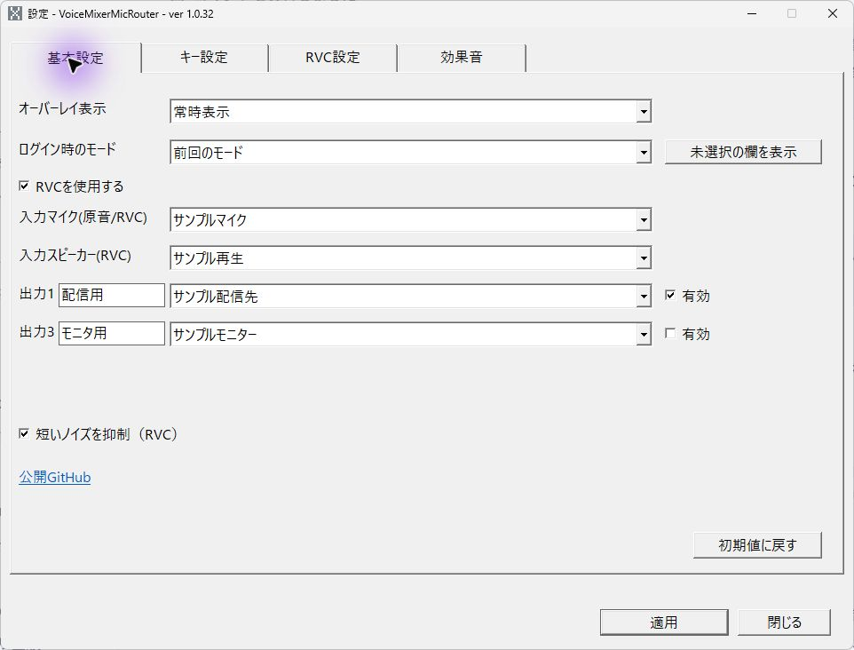
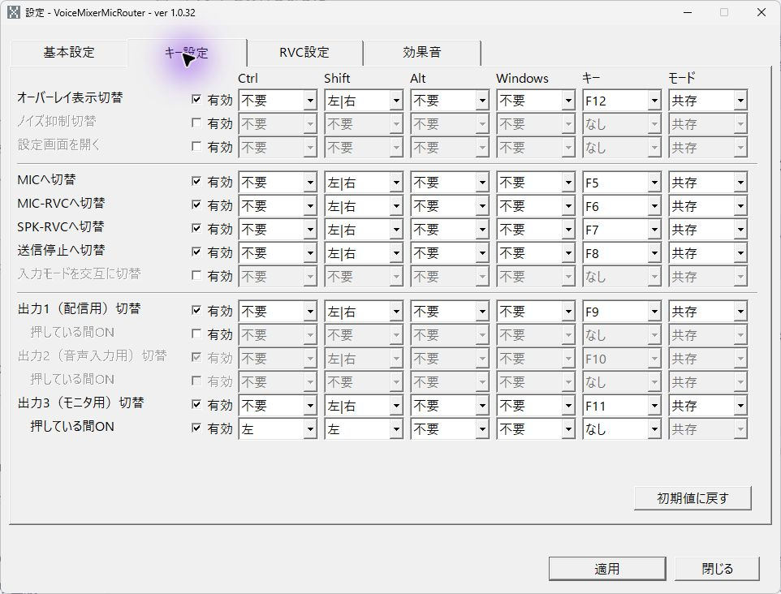
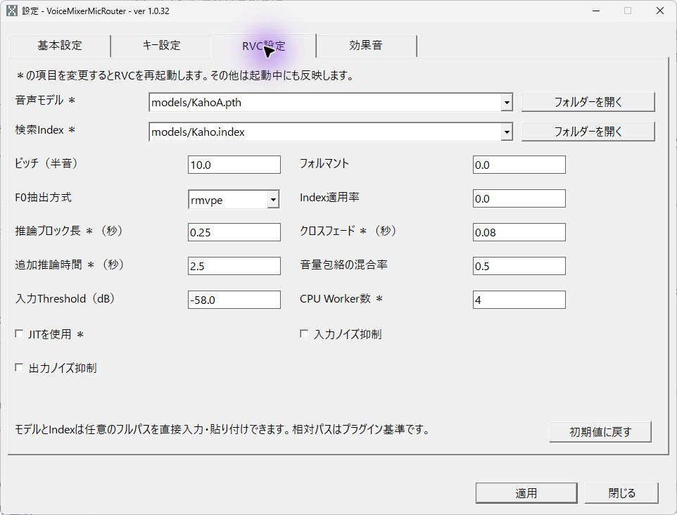
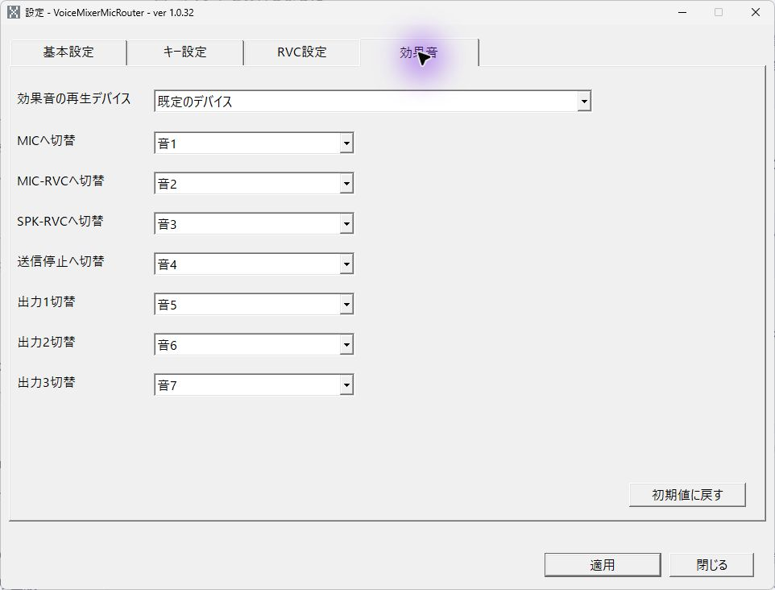
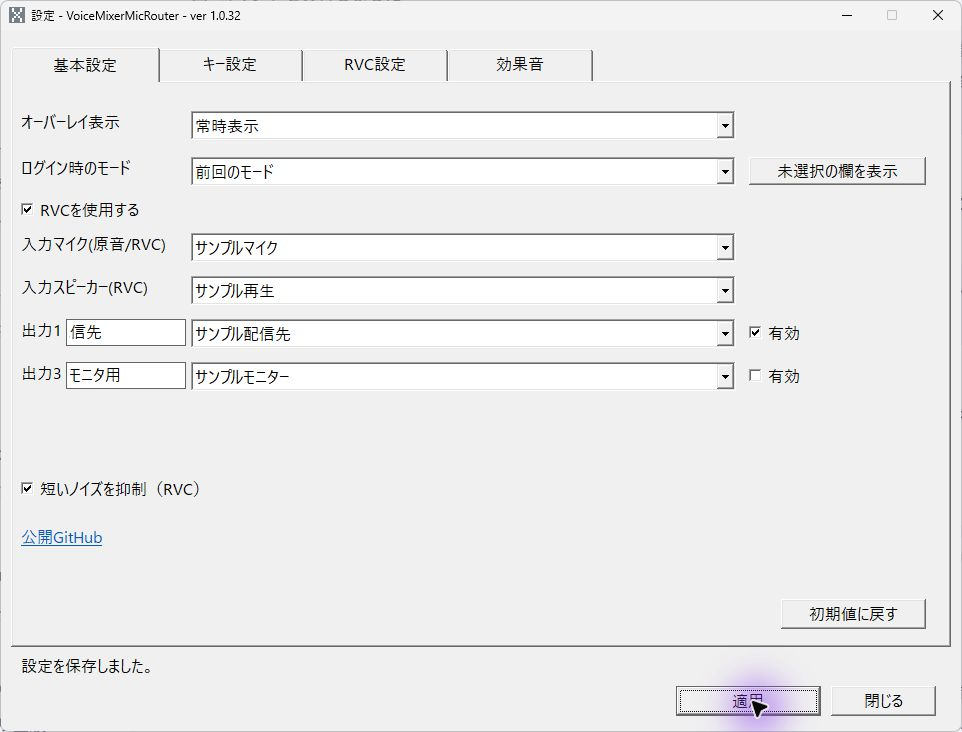

# VoiceMixerMicRouter

Windowsのタスクトレイに常駐し、MIC・MIC-RVC・SPK-RVC・停止を切り替えて、3つの出力デバイスへ音声を送ります。

VoiceMixer本体から独立したWin32アプリです。RVCモデルは初回選択時にバックグラウンドで準備し、読込中もMICへ戻せます。各出力のON/OFF、押している間ON、短い衝撃音の抑制、移動可能なオーバーレイに対応します。

- [利用方法](docs/mic-resident.md)
- [現行仕様](docs/mic-resident-spec.md)
- [ビルド・開発](docs/DEVELOPERS_GUIDE.md)
- [内部構造](docs/architecture/mic-resident.md)

## ダウンロード・インストール

[GitHub Releases](https://github.com/KotorinChunChun/VoiceMixerMicRouter/releases)から対象版の `setup.exe` を実行します。Windows 11 x64向けのユーザー単位インストーラです。Rustや.NETの事前導入は不要です。未署名の開発版として公開します。

初回は送信停止、RVC・全出力OFFで設定画面を開きます。設定を適用してから必要な出力を有効にしてください。[導入・更新・削除](docs/installation.md)、[KotorinToysへの登録引き継ぎ](docs/kotorintoys-integration.md)を参照してください。KotorinToys側の登録作業は管理PCで行います。

## 画面で見る使い方

以下は1.0.32の設定画面です。入力・出力は撮影用の架空デバイスで、実際の音声を転送した結果ではありません。

### 1. 入力と出力を選ぶ

起動時の設定画面、またはトレイから設定を開きます。「入力マイク」と出力先を選び、必要な出力だけを有効にします。オーバーレイ表示やログイン時のモードもここで指定します。「未選択の欄を表示」で省略された出力を選べます。

### 2. 切替キーを決める

「キー設定」で入力切替、出力切替、押している間ONなどのキーを選びます。「共有」は他アプリにもキーを渡し、「上書き」はこのアプリで扱うため、使い分けてください。

### 3. RVCを設定する

「RVC設定」でモデル・Index・ピッチなどを指定します。モデルと実行環境は別途必要です。星印の項目を変更するとRVCの再起動が必要になります。

### 4. 切替時の効果音を選ぶ

「効果音」で切替ごとの音と再生デバイスを選べます。配信先へ意図せず混ざらないよう、再生先を確認してください。

### 5. 適用結果を確認する

出力名などを変更して「適用」を押し、画面下部の保存結果を確認します。撮影例では出力1を「配信先」に変更しました。「閉じる」で設定画面を閉じても、通常起動した常駐アプリは動作を続けます。

## 保存・停止

設定とモデルは更新時も保持してください。音声を止めるには送信停止へ切り替え、常駐自体を終えるときはトレイから終了します。モデルの利用条件は各配布元を確認してください。

詳しい操作は[利用方法](docs/mic-resident.md)、トラブル時の確認とビルドは[開発者ガイド](docs/DEVELOPERS_GUIDE.md)に分けています。
